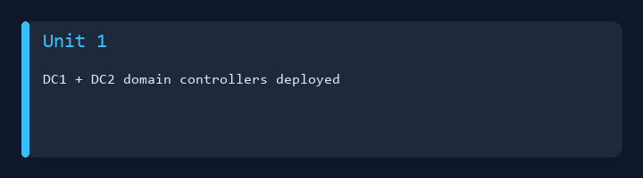
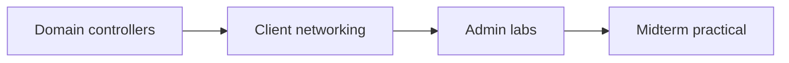

# IA 244 - Administration of Computer Systems



College coursework portfolio for **IA 244** at Eastern Michigan University.  
**Domain controller** labs, **Lab 4**, and **midterm** work — with screenshots readable on GitHub.

**Author:** [Julio Barros](https://github.com/Jkbarros)  
**Index:** [college-projects](https://github.com/Jkbarros/college-projects)

## What is in this repository

| Area | Description |
|------|-------------|
| [Submissions catalog](docs/submissions-catalog.md) | Map each assignment to markdown + PDF |
| [Unit 1 — DC lab](docs/unit-1-domain-lab.md) | DC1/DC2, client `ipconfig`, ping (Sally) |
| [Lab 4](docs/lab-4-administration.md) | Administration lab screenshots |
| [Midterm (parts 1 & 2)](docs/midterm-exam.md) | Exam captures (20 pages total) |
| [Doc1](docs/doc1-screenshots.md) | Extra screenshot pages |
| [Archive index](docs/archive-index.md) | Links to original PDFs in `archive/` |
| [`archive/canvas-submissions/`](archive/canvas-submissions/) | Canvas PDF exports |

### Highlights

- PDF pages extracted to **`docs/screenshots/`** for inline viewing in markdown
- Unit 1 documents a two–domain-controller lab plus client connectivity checks
- Scripts to regenerate assets (`extract_pdf_screenshots.py`, `generate_readme_demo.py`)

## Topics covered



## Regenerate docs assets

```bash
pip install -r requirements.txt
python scripts/extract_pdf_screenshots.py
python scripts/generate_readme_demo.py
```

## Related repos

| Course | Link |
|--------|------|
| IA 103 - Information Security Overview | [information-security-overview](https://github.com/Jkbarros/information-security-overview) |
| IA 329 - Policy Development | [ia329-policy-development-info-assurance](https://github.com/Jkbarros/ia329-policy-development-info-assurance) |
| college-projects index | [college-projects](https://github.com/Jkbarros/college-projects) |

## Notes for readers

- This repo documents **my submitted work** for academic context only.
- Screenshots may show lab hostnames/IPs from EMU coursework; treat as historical artifacts.

## License

Content © Julio Barros. Use at your own risk.
