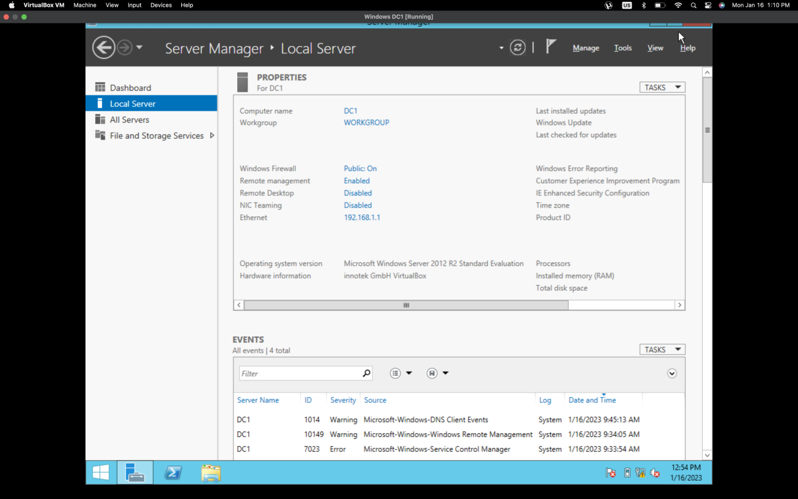
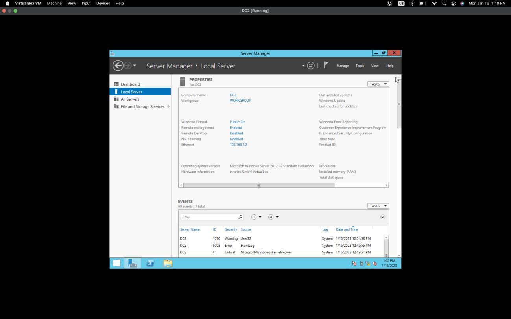
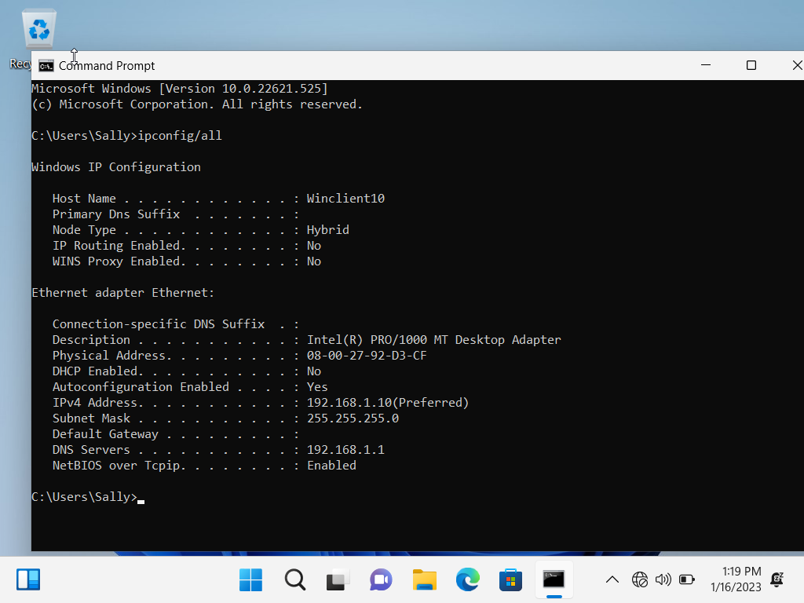
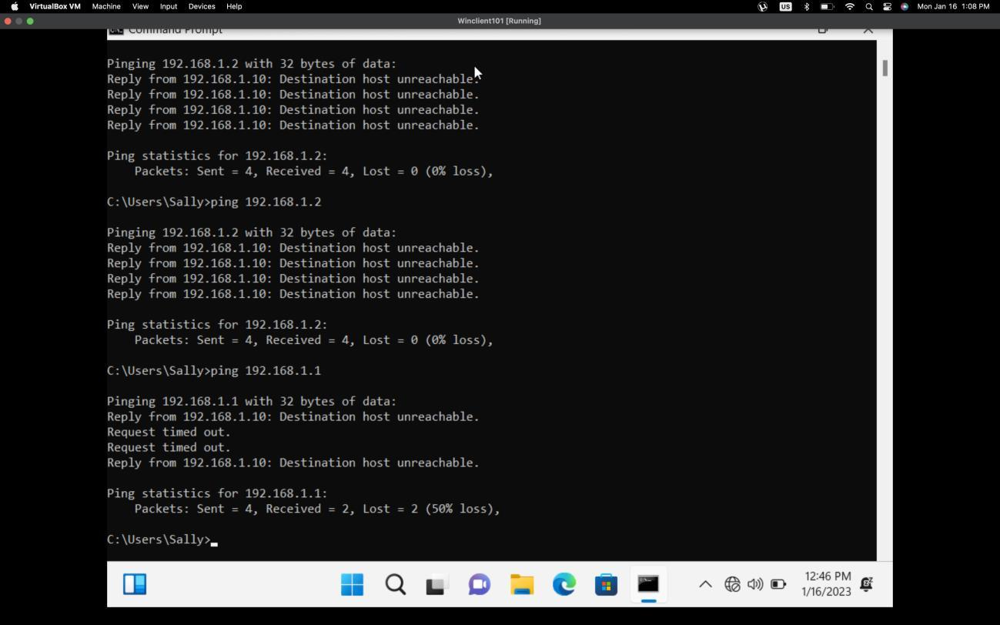

# Unit 1 — Domain controllers and client networking

**Source:** [`Julio Barros Unit 1.pdf`](../archive/canvas-submissions/Julio%20Barros%20Unit%201.pdf)  
**Course:** IA 244 - Administration of Computer Systems (EMU) · **Author:** Julio Barros

## Lab objectives (from submission)

1. **DC1** installed  
2. **DC2** installed  
3. **Command prompt from client** — `ipconfig /all`  
4. **Ping from client (Sally)** to both domain controllers  

## Screenshots

## Notes

- Captures document a small **Active Directory / domain controller** lab environment and client verification steps.
- Hostnames and IPs in images are **point-in-time** class lab values, not production systems.
